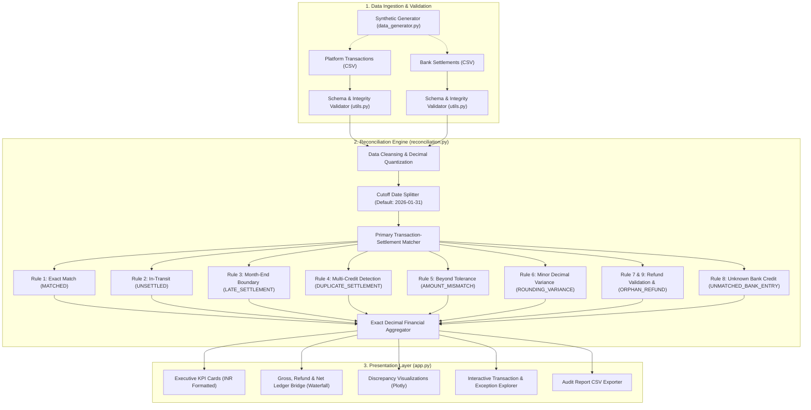

# System Architecture & Technical Specifications

## 1. Architectural Philosophy
The Payment Reconciliation and Gap Detection System is designed according to clean architecture principles:
1. **Separation of Concerns**: Complete decoupling between UI presentation (`app.py`), business logic (`reconciliation.py`), data generation (`data_generator.py`), and validation utilities (`utils.py`). The core engine can run in batch jobs, CLI pipelines, or interactive dashboards without modification.
2. **Deterministic Exactitude**: Absolute reliance on Python's `Decimal` type for monetary values. Floating-point arithmetic is strictly prohibited in financial paths.
3. **Graceful Fault Tolerance**: Multi-layered schema and date validation that isolates malformed records without halting processing.
4. **Transparent Auditability**: Every single record is tagged with human-readable financial explanations and recommended corrective actions.

---

## 2. High-Level Data Flow

---

## 3. Module Breakdown

### `config.py`
Centralized application configuration, enums, and constants:
* `DEFAULT_CUTOFF_DATE`: `2026-01-31`
* `DEFAULT_ROUNDING_TOLERANCE`: `Decimal("0.05")`
* `TransactionType`: `PAYMENT`, `REFUND`
* `PlatformStatus`: `SUCCESS`, `REFUNDED`
* `ReconciliationStatus`: `MATCHED`, `LATE_SETTLEMENT`, `ROUNDING_VARIANCE`, `DUPLICATE_SETTLEMENT`, `ORPHAN_REFUND`, `UNSETTLED`, `AMOUNT_MISMATCH`, `UNMATCHED_BANK_ENTRY`, `REFUND_EXCEEDS_PAYMENT`
* Design tokens, typography definitions, and status color maps.

### `utils.py`
Shared mathematical, formatting, and validation utilities:
* `to_decimal(val)`: Safely parses numbers/strings into exact `Decimal('0.01')` using `ROUND_HALF_UP`.
* `format_inr(val)`: Formats numbers using the Indian numbering system (`₹12,34,567.89`).
* `parse_date(val)`: Robust date parser supporting ISO (`YYYY-MM-DD`), Indian (`DD-MM-YYYY`), and slashed formats.
* `validate_transactions_csv(df)` & `validate_settlements_csv(df)`: Invariant assertions on mandatory columns, types, duplicate IDs, non-negative payments, and valid dates.

### `data_generator.py`
Self-contained synthetic generator:
* Seeded reproducibility (`seed=42`).
* Generates 135 platform records and 134 bank settlements.
* Intentionally plants all four mandatory anomaly scenarios in isolated records:
  * Scenario 1: Late settlement (Jan 31 txn settled Feb 01).
  * Scenario 2: Aggregate rounding differences (₹0.01–₹0.03 micro-variances).
  * Scenario 3: Duplicate bank credit entries.
  * Scenario 4: Orphan refund referencing non-existent payment ID.
* Produces a structured anomaly manifest for verification.

### `reconciliation.py`
The core financial engine:
* Pure, reusable function: `reconcile_transactions(transactions, settlements, cutoff_date, rounding_tolerance)`.
* Returns a 4-tuple: `(reconciled_df, exceptions_df, financial_summary, validation_report)`.
* Fully decoupled from Streamlit; importable into backend pipelines and test harnesses.

### `app.py`
Production-grade interactive financial analytics dashboard built with Streamlit and Plotly:
* Clean, white/light palette with dark navy typography (`#0F172A`, `#1E3A8A`).
* Responsive sidebar with cutoff date picker, tolerance slider, and CSV file uploaders with instantaneous integrity feedback.
* Six functional tabs/views: Executive Overview, Financial Ledger, Discrepancy Charts, Transaction Explorer, Forensic Investigator, and Report Exporters.

### `tests/test_reconciliation.py`
Pytest test harness covering 16 test cases (TC01 to TC16).

---

## 4. Reconciliation Engine Matching Algorithm

1. **Pre-processing**:
   - Normalize dates and convert amounts to `Decimal`.
   - Build a primary index mapping `transaction_id -> platform_record` for fast lookup and refund traceability.
   - Group settlements by `transaction_id` to detect multi-credit anomalies.

2. **Platform Loop (Records $\le$ Cutoff Date)**:
   - For each platform record:
     - If no settlement exists in the bank: Tag `UNSETTLED`.
     - If settlements exist:
       - Take first settlement as the primary candidate.
       - If `settlement_date > cutoff_date`: Tag `LATE_SETTLEMENT` (Timing difference).
       - If `transaction_type == REFUND`:
         - Validate `original_transaction_id` against platform records. If absent $\to$ `ORPHAN_REFUND`.
         - Validate refund amount $\le$ original payment amount. If exceeded $\to$ `REFUND_EXCEEDS_PAYMENT`.
       - If settled within cutoff:
         - Calculate $\Delta = \text{Bank Amount} - \text{Platform Amount}$.
         - If $|\Delta| == 0 \to$ `MATCHED`.
         - If $0 < |\Delta| \le \text{Tolerance} \to$ `ROUNDING_VARIANCE`.
         - If $|\Delta| > \text{Tolerance} \to$ `AMOUNT_MISMATCH`.

3. **Bank Duplicate Loop**:
   - Scan settlement groups where `count(settlement_id) > 1` for the same `transaction_id`.
   - The second and subsequent settlements are tagged as `DUPLICATE_SETTLEMENT` and quarantined.

4. **Unmatched Bank Loop**:
   - Process any remaining bank settlements whose `transaction_id` does not match any platform transaction:
     - If `type == REFUND` $\to$ `ORPHAN_REFUND`.
     - If `type == PAYMENT` $\to$ `UNMATCHED_BANK_ENTRY`.

5. **Financial Aggregation**:
   - Aggregate gross platform payments, platform refunds, net platform receipts.
   - Aggregate in-period bank credits, bank refund debits, net bank receipts.
   - Compute reconciliation bridge metrics: In-transit, late settlements, duplicate quarantined funds, orphan refunds, and rounding variances.
